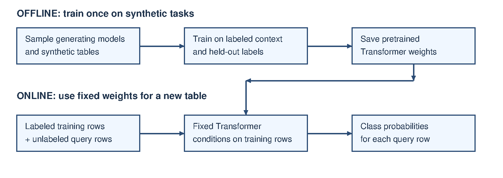

# TabPFN: A Transformer That Solves Small Tabular Classification Problems in a Second

## Overview

TabPFN is a pretrained classifier for small tables, not a boosted-tree model fitted separately to each dataset. Given labeled rows and unlabeled query rows, its Transformer outputs class probabilities without updating its weights on the new dataset. Its predictions approximate Bayesian inference under a synthetic-data prior, so their usefulness depends on how well that prior fits the task. [S1] [S2]

## What

The authors train one network offline on many artificially generated classification datasets. At use time it takes a numerical feature vector and class label for each training row, plus feature vectors for query rows, and returns a probability distribution over classes for each query. The main evaluation targets at most 1,000 training rows, 100 numerical features without missing values, and 10 classes; this is classification, not the paper's proposed future extension to regression. [S1] [S3] [S4]

## Terminology

| Term | Meaning in this paper | Why it matters |
| --- | --- | --- |
| Prior over datasets | A procedure that samples data-generating mechanisms and then synthetic datasets from them. [S1] | It encodes the assumptions the pretrained model brings to a new task. |
| Posterior predictive distribution (PPD) | The distribution of a query's label given its features and the labeled rows, averaging over possible generating mechanisms weighted by prior and data. [S1] | TabPFN approximates this distribution; it does not explicitly identify one best mechanism. |
| Prior-data fitted network (PFN) | A network trained on synthetic datasets to approximate a prior's PPD. [S1] | The expensive learning algorithm is acquired offline and reused on new datasets. |
| Structural causal model (SCM) | A graph of variables generated from their parents and noise; some variables are selected as features and one as the target. [S2] | It generates correlated synthetic tables, but using it as a prior does not make TabPFN a causal-effect estimator. |
| In-context learning | Conditioning the fixed network on labeled rows included in its input, rather than fitting its weights to those rows. [S1] | The new dataset influences predictions while the network parameters stay unchanged. |

## Why

**Why solve this problem?** Small tabular classification problems are common, but choosing and tuning models for every dataset takes time and compute. [S1] [S3]

**What did prior work do?** Müller et al.'s earlier PFN learned Bayesian prediction from synthetic tasks, but its tabular demonstration was limited to balanced binary problems with 30 training examples. Separately, Auto-sklearn 2.0 searches and ensembles models for each dataset, trading compute for predictive performance. [S1] [S3] [S5]

**What does this paper do differently, and why?** It trains a PFN once on a richer mixture of SCM and Bayesian neural-network datasets, including multiclass and imbalanced tasks, so a fixed model can condition on a new small table directly. This shifts computation to offline training and makes inference fast, but its predictions are shaped by the synthetic prior and can be weaker when the real table differs from the intended domain. [S1] [S2] [S3]

## When

A data scientist with a small numerical table, such as a software-defect dataset with labeled past records, can use TabPFN as a quick classification baseline and compare it with tuned tree or AutoML models on held-out rows. The paper compares XGBoost, LightGBM, CatBoost, Auto-sklearn 2.0 and AutoGluon on five train/test splits; its aggregate ROC AUC assesses discrimination on those datasets, not reliability or fairness on a new application. Check the actual task with a leakage-free holdout and compare baselines; categorical values, missing data, irrelevant features, larger datasets and distribution shifts need separate scrutiny. [S3] [S4]

On 18 numerical OpenML-CC18 datasets, the 32-pass ensemble had mean ROC AUC 0.934 versus AutoGluon's 0.930; average total per-dataset time was 0.617 seconds on GPU or 37.59 seconds on CPU for TabPFN versus 3,077 seconds on CPU for AutoGluon. These are aggregate results from the authors' setup, not a guarantee for every table; they exclude one-time development and pretraining costs. [S3] [S5]

## How

1. **Generate tasks offline.** Sample either an SCM or a Bayesian neural network and generate rows from it. Transform continuous synthetic targets into discrete classes, including imbalanced classes; the prior favors simpler generating graphs. [S2]
2. **Prior-fit once.** Split each generated dataset into labeled context and held-out examples. Train the Transformer by cross-entropy on the held-out labels; the paper reports 20 hours on eight GPUs for its final model. [S1]
3. **Predict on a new table.** Normalize features using training rows, supply those rows with labels and the query rows without labels, and run the fixed model to obtain class probabilities. Training rows attend to one another; each query attends to training rows, not other queries. [S1] [S5]
4. **Optionally ensemble.** The paper also averages predictions from 32 forward passes with feature-column and label-index rotations and optional power transforms. Thus the reported ensemble time is not the time for a single forward pass. [S1] [S3] [S5]

*Original summary based on [Figure 1 and Sections 2–3](https://arxiv.org/pdf/2207.01848v6#page=3): offline training is reused; real labeled rows condition prediction rather than updating the weights. [S1]*

## Worked Example

**Illustrative example:** Suppose a numerical table has three labeled rows `(1, 0)`, `(2, 0)`, `(5, 1)`, where the first value is the feature and the second the class; the query feature is `4`. TabPFN receives the three labeled rows and the unlabeled query together, after preprocessing based on the labeled rows. The fixed network uses this context to produce probabilities for classes 0 and 1. If its output were `(0.3, 0.7)`, choosing the most probable class would yield class 1. These probabilities are hypothetical, not computed or reported paper results; they cannot be deduced from the rows alone. [S1] [S5]

For a concrete offline task, the paper's Section 4.5 uses synthetic continuous targets with bounds `-0.1` and `0.5`: `-0.1`, `0.3`, and `0.9` map to classes 0, 1, and 2 respectively before the class labels are shuffled. The PFN is trained to predict held-out synthetic labels from the remaining labeled rows, not to apply these bounds to the real query above. [S2]

## Differentiators

- **A prior rather than a single fitted graph:** The SCM and neural-network mixture generates diverse tasks; the network approximates their averaged posterior predictions, without recovering a causal graph or estimating an intervention effect. [S1] [S2]
- **Offline cost versus per-table cost:** The paper's pretrained network is reused across datasets, while its AutoML baselines search and fit per dataset. The one-time training and algorithm-development costs are excluded from reported per-table timings. [S1] [S3] [S5]
- **Scope rather than a universal speed claim:** The 32-pass ensemble takes 37.59 seconds on CPU on average in the main comparison; the non-ensembled version averages 1.30 seconds on CPU and 0.052 seconds on GPU. Categorical and missing values and uninformative features can hurt performance. [S3] [S4]

## Relationships

No typed relationships to existing wiki entries have been established. [S1]

## Source Locators

- S1: Sections 1–3 and Figure 1, pp. 1–4
- S2: Sections 4.1–4.5 and Figure 2, pp. 4–6
- S3: Section 5.2, Figure 5 and Table 1, pp. 7–9
- S4: Section 6 and Appendix B.3.2, pp. 10 and 18–19
- S5: Appendices C.2.1, C.2.6, E.2 and F.5, pp. 27–30 and 33

## FAQ
