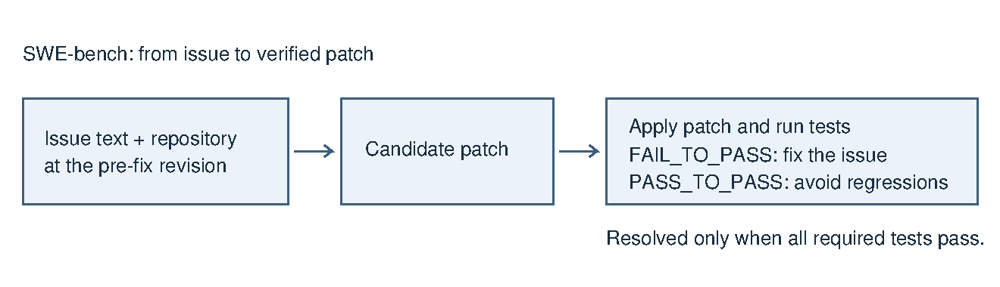

# SWE-bench: Can Language Models Resolve Real-World GitHub Issues?

## Overview

SWE-bench asks whether a language model can fix a real GitHub issue in an existing codebase, not just complete a standalone function. Given the issue and the repository at its pre-fix revision, the model submits a patch; the evaluator applies it, runs task-specific tests, and reports the percentage of issues resolved. [S1]

## What

The original benchmark contains 2,294 tasks from 12 Python repositories. A task combines issue text, a repository revision, and evaluator-side tests derived from a merged pull request. The human patch helps establish which tests should change or stay green; the model's patch need not resemble it. [S1] [S2]

## Terminology

| Term | Meaning in this paper | Why it matters |
| --- | --- | --- |
| Base commit | Repository revision before the reference fix. | Gives the proposed patch the same starting state as the benchmark task. |
| Gold patch | The code changes from the merged human pull request. | Establishes expected test outcomes; it is not the text an answer must match. |
| FAIL_TO_PASS | Tests that fail before the human fix and pass after it. | Check that the submission fixes the behavior the task targets. |
| PASS_TO_PASS | Tests that pass both before and after the human fix. | Check for regressions in behavior covered by those tests. |

## Why

**Why solve this problem?** Real issues rarely name every file that needs changing. A fix may require locating the right code, understanding existing behavior, and preserving it while handling a new case. [S1] [S5]

**What did prior work do?** HumanEval measures function-level synthesis and checks generated functions with tests. It does not require the model to find the relevant code or coordinate changes across an existing repository. [S5]

**What does this paper do differently, and why?** It keeps the original issue and repository context and uses the merged fix to identify checks for new and existing behavior. That makes the task closer to real maintenance, but a passing score still says only what the selected tests cover. [S1] [S2] [S5]

## When

Use SWE-bench if you build a coding assistant and want to compare model or retrieval configurations on repository issue resolution. The paper compares commercial models such as Claude 3 Opus and GPT-4-turbo with tuned SWE-Llama variants under BM25 file retrieval. Hold the task set and context strategy fixed when comparing models: the score measures tested issues resolved under that setup, not general software engineering ability, maintainability, or coverage beyond the Python repositories sampled. [S4] [S5]

## How

1. **Construct tasks.** Start with merged pull requests that resolve an issue and change tests. Run those tests on the base revision and again with the human fix. Keep tasks with at least one failing test that the fix makes pass, and discard broken setups. [S1]
2. **Generate a candidate.** Provide the issue and repository context. The paper's baseline prompts use selected files: BM25 ranks files by relevance to the issue, while the oracle comparison gives the model the files the human patch edited, information it would not normally have. [S1] [S4]
3. **Score the candidate.** Apply the patch and run the task tests. A task counts as resolved only if every required FAIL_TO_PASS and PASS_TO_PASS test is present and passing. An unusable patch or a missing required passing result does not resolve the task. [S2]

*Original diagram. A patch applying cleanly is not enough: both sets of required tests must pass. See [Section 2.2](https://arxiv.org/pdf/2310.06770v3#page=3) and [Appendix A.4](https://arxiv.org/pdf/2310.06770v3#page=20).*

## Worked Example

**Paper example:** In Sphinx task `sphinx-8713`, the issue asks the Napoleon documentation extension to respect a configuration option when formatting “Other Parameters.” In the paper's oracle setting, the model gets the issue and the contents of the relevant file. It edits the right function, but makes it behave as though the option were always enabled. A test that disables the option fails. Even though the patch applied and many tests passed, the evaluator counts the issue as unresolved. [S2] [S3]

## Differentiators

- **Behavior, not patch similarity.** The human patch supplies a reference for choosing tests; an alternative implementation can resolve the issue if it passes those tests. [S1] [S2]
- **Benchmark versus baseline.** The task is repository issue resolution. The paper's retrieval-and-patch experiments are one approach, not a requirement that future systems avoid repository navigation or tool use. [S1] [S4] [S5]

## Relationships

- **Contrasts with** [Terminal-Bench](../2026/arxiv-2601.11868.md): SWE-bench concentrates on patches for repository issues, whereas Terminal-Bench covers broader command-line work. Its adapter catalog lists the later human-validated SWE-bench Verified subset, not the original full 2,294-task set as part of Terminal-Bench's own task suite. [S1] [S6]

## Source Locators

- S1: SWE-bench v3, Sections 2.1–2.2, pp. 2–3
- S2: SWE-bench v3, Appendix A.4, pp. 20–21
- S3: SWE-bench v3, Section 5.1 and Figure 6, pp. 8–9
- S4: SWE-bench v3, Sections 4.1–4.3 and Table 5, pp. 4–6
- S5: SWE-bench v3, Sections 6–7, pp. 9–10
- S6: Terminal-Bench v1, Appendix D and Table 5, p. 84 (https://arxiv.org/pdf/2601.11868v1#page=84)

## FAQ
