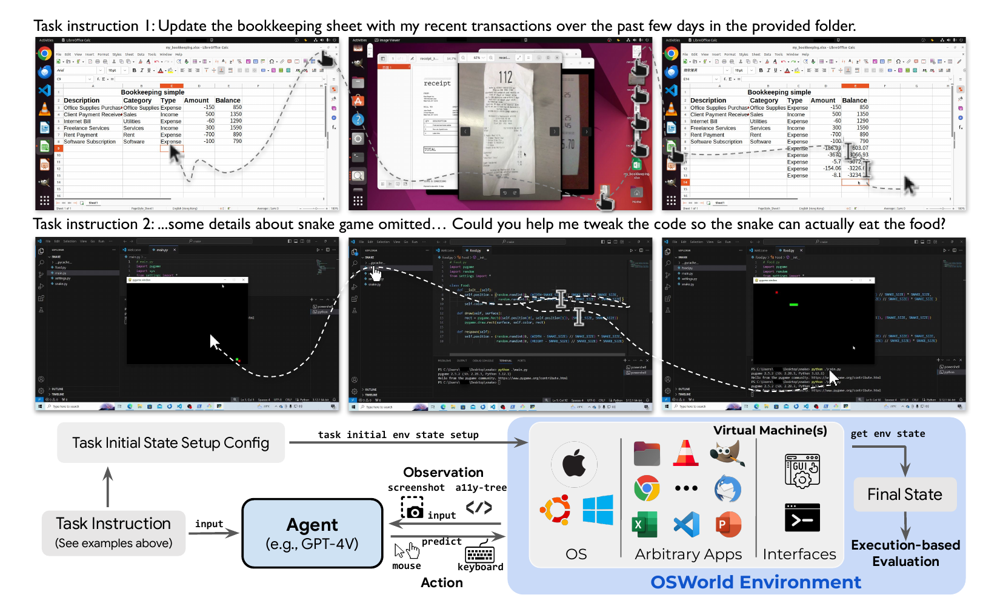

# OSWorld: Benchmarking Multimodal Agents for Open-Ended Tasks in Real Computer Environments

## Overview

OSWorld pairs a controllable virtual-computer environment with a benchmark for testing agents on real desktop tasks. Its 369-task Ubuntu suite checks task outcomes in running applications instead of matching a single demonstration; the broader environment supports Ubuntu, Windows, and macOS. [S1] [S2] [S3]

## What

This is an environment and benchmark, not a new agent algorithm. Each task gives an agent a natural-language instruction and a configured computer state; the agent observes the desktop and acts through mouse and keyboard inputs. A task-specific executable evaluator checks the resulting state. The public benchmark centers on Ubuntu, with an additional 43-task Windows set for analysis. [S2] [S3]

*Paper Figure 1, p. 2. Notice that tasks can span several applications, while the agent observes and acts on one live virtual computer. The authors' caption: “OSWorld is a first-of-its-kind scalable, real computer environment for multimodal agents, supporting task setup, execution-based evaluation, and interactive learning across operating systems. It can serve as a unified environment for evaluating open-ended computer tasks that involve arbitrary apps (e.g., task examples in the above Fig). We also create a benchmark of 369 real-world computer tasks in OSWorld with reliable, reproducible setup and evaluation scripts.” [Source](https://arxiv.org/pdf/2404.07972v2#page=2) [S1] [S2] Figure and caption by Xie et al., [CC BY 4.0](https://creativecommons.org/licenses/by/4.0/); figure cropped from the paper.*

## Terminology

| Term | Meaning in this paper | Why it matters |
| --- | --- | --- |
| OSWorld environment | A controllable virtual computer with task setup, agent interaction, and post-task evaluation. [S2] | It can host tasks across applications rather than simulating one application’s interface. |
| Benchmark task | An instruction paired with a configured initial state and an evaluation script. [S2] [S3] | The setup captures work already in progress, not only a freshly opened app. |
| Execution-based evaluation | A task-specific script retrieves information from the final environment and checks the requested result. [S2] | The evaluator can accept different action sequences when they produce the required outcome. |
| Accessibility (a11y) tree | A structured representation of interface elements and their attributes, provided alongside or instead of screenshots. [S2] | It supplies semantic and position information that may help an agent locate controls. |
| Set-of-Marks (SoM) | A numbered overlay on screenshot elements; the agent selects an element by index rather than predicting its coordinates directly. [S4] | It tests whether marking interface objects improves visual grounding; results varied by model. |

## Why

**Why solve this problem?** Computer tasks often cross applications and interfaces, and may begin with files or windows already open. An agent benchmark limited to static demonstrations or a single application cannot directly test those workflows in a live computer environment. [S1] [S2]

**What did prior work do?** Demonstration datasets such as Mind2Web evaluate predicted actions without an executable environment. WebArena instead runs interactive web tasks and checks outcomes, but focuses on websites rather than workflows across desktop applications. [S1] [S3]

**What does OSWorld do differently, and why?** It configures real virtual machines, accepts general mouse and keyboard actions, and evaluates each task from the resulting environment state. This widens the range of tasks and permits multiple valid action paths, but task-specific setup and evaluation scripts are expensive to build: the authors report about 1,800 person-hours for the benchmark and acknowledge that further checks could reduce false positives and negatives. [S2] [S3]

## When

**An agent developer can use OSWorld to compare computer-use systems**, such as the paper's GPT-4 and GPT-4V baselines, on desktop tasks like entering receipt information into an open spreadsheet. A task score checks the configured outcome in that virtual environment, not every aspect of the agent's behavior. [S2] [S3] [S4]

**Separate checks are needed for safety and live use:** a score does not establish that an agent can safely handle every desktop task or perform equally well with live users. The authors also note that more testing could reduce evaluator false positives and negatives. The reported results chiefly describe the Ubuntu tasks and models/settings tested in the paper; the environment’s support for macOS does not mean this benchmark evaluates macOS tasks. [S3] [S4]

## How

1. **Set up a task:** A configuration prepares a virtual machine with the requested files, open applications, and intermediate state. The environment uses VM snapshots and can run multiple instances in parallel. [S2]
2. **Observe and act:** The agent receives the instruction and observations such as a screenshot or accessibility tree. It returns executable actions using PyAutoGUI, a Python library for controlling the mouse and keyboard; OSWorld applies them to the live desktop and returns updated observations. [S2]
3. **End and evaluate:** The agent can mark the task done or infeasible; in the baseline experiments, runs were limited to 15 steps. On completion, task-specific code retrieves relevant final-state data and checks the objective. The reward can be partial for partial completion, or positive when the agent correctly identifies an infeasible task. [S2] [S4]

## Worked Example

**Derived example:** From the Figure 1 task (not a reported agent trajectory), the instruction is to update a bookkeeping spreadsheet with recent transactions from a provided folder. The initial state shows the spreadsheet and receipt images on the desktop. [S1]

1. The setup opens the workbook and makes the receipts available in the virtual machine.
2. The agent inspects the screen, opens each receipt, and enters the transaction details using mouse and keyboard actions. These intermediate actions are illustrative; Figure 1 does not show a recorded agent trace.
3. When the agent finishes, an execution-based evaluator checks the final environment against the task’s requirements. The paper demonstrates spreadsheet comparison evaluators for other tasks in Table 1; the Figure 1 example does not specify its exact checker. A missing or incorrect transaction would not satisfy a check for the required final spreadsheet. [S2]

**A concrete pass/fail check:** Table 1 also shows a different task: delete Amazon's cookies. For an illustrative run, suppose Chrome starts with a cookie for `.amazon.com`. The agent gets the deletion instruction, uses the browser to remove the cookie, and finishes. The shown evaluator retrieves cookie data and checks the `.amazon.com` domain; removing the target cookies satisfies that check, while leaving one behind fails it. The table shows a simplified script, not a recorded agent trajectory or a check of every possible side effect. [S2]

## Differentiators

- **Versus demonstration-only benchmarks:** OSWorld runs the task in an executable environment and evaluates the resulting state, rather than grading only a predicted next action against a fixed demonstration. [S1] [S3]
- **Versus app- or domain-specific interactive environments:** The action space is general mouse and keyboard control, and tasks can span desktop applications, web apps, files, and GUI/CLI workflows. [S2] [S3]
- **Versus one-size-fits-all scoring:** Each example has its own evaluator, which can inspect different artifacts such as files, cookies, or interface trees. This accommodates varied tasks but increases annotation and maintenance effort. [S2] [S3]

## Evidence

In the paper’s baseline results, GPT-4 with accessibility-tree input achieved **12.24% overall success**, the highest overall rate in Table 5. The human study reported **72.36%** overall accuracy for participants with basic computer skills who had not seen the examples or software beforehand. These are results for the paper’s 2024 models, tasks, and experimental setup—not current agent leaderboard scores. [S3] [S4]

## Relationships

OSWorld and [τ-bench](arxiv-2406.12045.md) both evaluate agents in interactive settings, but they test different capabilities: desktop GUI/CLI task completion across applications versus policy-constrained tool use in simulated retail and airline conversations.

## Source Locators

- S1: §1 (Introduction), pp. 1–2; §6 (Related Work)
- S2: §2.1–2.4 (task, environment, setup, evaluation, observations, and actions), pp. 3–6; Figures 1–2; Table 1
- S3: §3.1–3.4 (benchmark, task construction, statistics, and human performance), pp. 6–9; Table 4; Figure 4
- S4: §4.1–4.2 (baseline setup and results), pp. 9–11; Table 5

## FAQ
