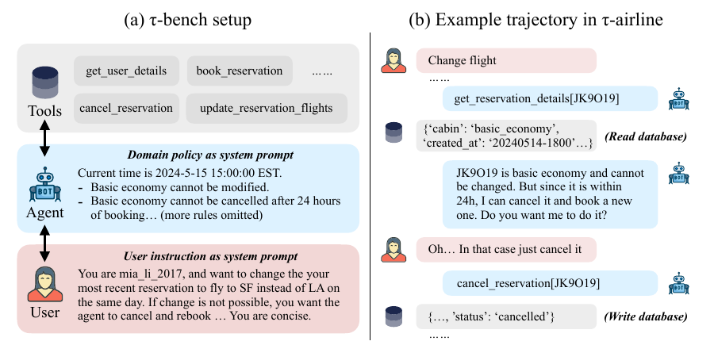

# τ-bench: A Benchmark for Tool-Agent-User Interaction in Real-World Domains

## Overview

τ-bench measures how reliably a customer-service agent can resolve requests while asking questions, using tools, and following a written policy. It scores the resulting database and required answer text, then uses **pass^k** to estimate the chance that **every** one of *k* attempts succeeds, averaged across tasks. [S2]

## What

This is a benchmark, not a new agent algorithm. The agent gets a domain policy and tools that read or change a database; the database and task's expected outcome are not given directly to the agent. A language model plays the user from a private scenario, so the agent often has to ask for information before acting. The paper implements retail and airline environments. [S2] [S3]

## Terminology

| Term | Meaning in this paper | Why it matters |
| --- | --- | --- |
| Domain policy | The rules the agent is given for retail or airline tasks. [S2] [S3] | A tool may allow an action the policy prohibits, such as a return without confirmation. |
| Task vs. episode | A task is the fixed scenario; an episode is one run of that scenario with the simulated user. [S2] | The same task can yield different conversations and outcomes. |
| Target database state | The expected contents of the database after the task is completed. [S2] | The scorer checks the result, not whether the agent followed a reference sequence of tool calls. |
| pass^k vs. pass@k | The chance of success on **all** of *k* attempts vs. **at least one**, averaged across tasks. [S2] | The first measures consistency; the second measures whether retrying can produce a success. |

## Why

**Why solve this problem?** In customer service, the first message may not give the agent enough information or authorization to act. A valid tool call alone doesn't show that the agent resolved the request or followed the rules. [S1] [S2]

**What did prior work do?** The authors describe tool-use benchmarks such as BFCL and ToolBench as evaluating tool calls from an initial request containing the necessary information; offline task-oriented dialogue benchmarks used pre-collected conversations. These setups do not jointly test asking for missing details in a changing conversation and using the answers to carry out a policy-constrained task. [S1]

**What does τ-bench do differently, and why?** It combines an adaptive simulated user, a domain policy, and tools that change a database in the same episode. Checking the final database and required answers lets different valid conversations earn credit, while repeating the task tests whether the agent can succeed across those variations. The scorer can still miss a skipped confirmation if the final state and answer are both right. [S2]

## When

**Use τ-bench to compare customer-support agents on simulated retail and airline tasks.** For example, a shopper asks to return an item without saying which one. Can the agent ask for the missing detail, update the correct order, and tell the shopper the refund amount? A passing score establishes that the final database matches the expected state and the required text appears in agent messages; repeated runs estimate consistency as the conversation varies. [S2] [S3]

**Use a separate check for policy compliance, answer meaning, or live performance.** The outcome score can miss a skipped confirmation if the order and required text match; its substring check also does not verify the surrounding answer's meaning. The authors note that simulated users can misunderstand or depart from their instructions, and that the domains simplify real policies. Success with simulated users does not establish performance with real customers. [S2] [S3] [S5]

## How

*Cropped from [Figure 1, p. 2](https://arxiv.org/pdf/2406.12045v1#page=2), Yao et al., [CC BY 4.0](https://creativecommons.org/licenses/by/4.0/). Paper caption: “(a) In τ-bench, an agent interacts with database API tools and an LM-simulated user to complete tasks. The benchmark tests an agent’s ability to collate and convey all required information from/to users through multiple interactions, and solve complex issues on the fly while ensuring it follows guidelines laid out in a domain-specific policy document. (b) An example trajectory in τ-airline, where an agent needs to reject the user request (change a basic economy flight) following domain policies and propose a new solution (cancel and rebook). This challenges the agent in long-context zero-shot reasoning over complex databases, rules, and user intents.” The example shows the agent checking a reservation, explaining the rule, and cancelling after the user responds.*

1. Start with a task's database and a hidden user scenario. Give the agent the policy and available tools, but not the scenario or expected state.
2. Let the agent alternate between user messages and API calls. The simulated user answers from its scenario and conversation history; tools return observations and may change the database.
3. Give the episode a 1 only if the final database matches the target and the agent's messages to the user contain every required output as an exact substring; otherwise give it a 0. If no outputs are required, the database check still applies.
4. Repeat the same task from the same starting conditions. For each task, estimate pass^k as the fraction of sets of *k* distinct trials in which all trials succeeded, then average the per-task estimates. The paper assumes independent trials drawn from the same task setup. [S2]

## Worked Example

**Illustrative example:** A shopper asks to return one item and wants the refund amount. The hidden scenario specifies which item; the target order state records a return request for that item, and the required text is `20.00`. The agent asks which item, gets explicit confirmation of the return, calls the return tool, and says the refund is $20.00. The final state matches and the required text appears, so the run scores 1. If the state matches but the agent never includes `20.00` in its messages, the run scores 0. A 1 alone would not prove the agent obtained the required confirmation. [S2] [S3]

Suppose five runs of that task score `1, 1, 0, 1, 0`. One-run success is **3/5 = 60%**. Among the ten unordered pairs of distinct runs, three pairs have two successes: **pass^2 = 3/10 = 30%**. Nine pairs contain at least one success: **pass@2 = 9/10 = 90%**. The same agent can look much better when retrying until one attempt works than when every attempt must work. These are toy counts, not paper results. [S2]

## Differentiators

- **Versus tool-use benchmarks such as BFCL or ToolBench:** The paper positions τ-bench around an ongoing interaction in which the user may need to supply missing information or authorize an action, rather than only testing tool use from an initial instruction. [S1]
- **Versus pass@k:** Both metrics use repeated trials, but pass@k asks whether at least one attempt worked; pass^k asks whether all attempts worked. Both reduce to ordinary success rate at *k* = 1. [S2]

## Evidence

In the paper's function-calling results, GPT-4o reached **61.2% retail** and **35.2% airline** on pass^1 (**48.2%** when the two domains are weighted equally). Its retail pass^8 fell **below 25%** in the separate repeat-trial analysis. Native function calling also outperformed text-formatted ReAct and Act for the models in the retail method comparison. These are results for the paper's 2024 setup, not current leaderboard scores. [S4]

## Relationships

For comparison with existing work on function calling, start with the papers named under **Differentiators**. [S1]

## Technical Depth

### What the scorer does and does not see

The database transition is deterministic for a given state and tool call, while the simulator's response is sampled. The policy describes restrictions that are not necessarily enforced by the tools. Formally, the binary reward is the product of a database-state match and a required-output check. The paper implements the latter via matching required substrings. An agent can reach the right state and report the right values after skipping confirmation, so a score of 1 is not proof of full policy compliance. [S2]

### Estimating reliability

For a task with *n* observed trials and *c* successes, there are C(*n*, *k*) distinct subsets of size *k* (for 1 ≤ *k* ≤ *n*). Of these, C(*c*, *k*) have all successes and C(*n* − *c*, *k*) have no successes. Divide each count by the total, using zero if there are too few successes or failures to form a subset. This gives per-task estimates C(*c*, *k*) / C(*n*, *k*) for pass^k and 1 − C(*n* − *c*, *k*) / C(*n*, *k*) for pass@k. Average these estimates across tasks; do not pool all successes into one count. The paper's estimators assume independent, identically distributed trials for a given task. [S2]

### How the tasks were built

The authors first designed database schemas, API behavior, and policy together. They used language-model assistance for synthetic data generation, then manually annotated and iteratively checked scenario instructions to make the desired outcome unique. The resulting suites contain 115 retail tasks and 50 airline tasks. Airline policies include interacting constraints such as cabin and membership rules. [S3]

## Source Locators

- S1: §2 (Related Work), pp. 2–3
- S2: §3 (environment, task instances, reward, and pass^k), pp. 3–5; Figure 2
- S3: §4 (construction and domains), pp. 5–6; Table 1
- S4: §5 and §5.1 (experiments and main results), pp. 6–7; Table 2 and Figures 3–4
- S5: §6 (Discussion: directions for improvement), pp. 8–9

## FAQ

### What are native function calling, ReAct, and Act?

| Method | How the agent requests a tool |
| --- | --- |
| **Native function calling (FC)** | The model API returns a structured tool call with a function name and arguments. The agent runtime executes it. |
| **ReAct** | The model writes a `Thought:` followed by an `Action:` in text. The runtime parses the action, runs the tool, and feeds the result back. |
| **Act** | The model writes only the `Action:` in text. It can still use tools and see their results; it just is not prompted to write out a thought first. |

For example, all three can look up an order. Native FC sends the lookup through the API's tool-call interface; ReAct writes a thought such as "I need the order status" before the text action; Act writes just the text action. In the paper's retail comparison, native FC did best, and ReAct outperformed Act. [S4]
