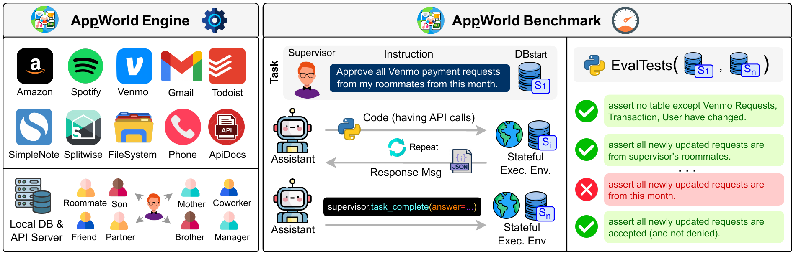

# AppWorld: A Controllable World of Apps and People for Benchmarking Interactive Coding Agents

## Overview

AppWorld pairs a controllable simulator of everyday apps and people with 750 benchmark tasks that require agents to write and iteratively run code. Instead of matching a single sequence of actions, task-specific tests check the resulting app data for the requested outcome and unwanted changes; some tasks also ask for an answer. [S1] [S3]

## What

AppWorld is an interactive coding benchmark and app simulator, not a new agent model. An agent receives a natural-language task and access to API documentation and a stateful execution shell, a workspace that remembers variables between runs. An API (application programming interface) lets the agent read or change app data through documented functions; the agent writes code, observes the results, and decides what to run next. The benchmark covers nine simulated day-to-day apps and fictitious people, and measures success on individual tasks and consistency across variations of a scenario. [S2] [S3] [S4]

*Cropped from Figure 2, p. 3, in Trivedi et al. (2024), [“AppWorld: A Controllable World of Apps and People for Benchmarking Interactive Coding Agents”](https://aclanthology.org/2024.acl-long.850.pdf), licensed under [CC BY 4.0](https://creativecommons.org/licenses/by/4.0/). Original caption: “(Left) AppWorld Engine is a feature-rich API-based app simulator based on 9 real-world day-to-day apps populated with data simulating the digital activities of fictitious people living in this world. (Right) AppWorld Benchmark is a collection of complex everyday tasks requiring interactive coding with API calls, which come with reliable programmatic state-based evaluation suites robustly capturing goal completion criteria.” [S2]*

## Terminology

| Term | Meaning in this paper | Why it matters |
| --- | --- | --- |
| Task scenario vs. task | A scenario is a blueprint; each task is a particular instruction and starting state instantiated from it. The benchmark has 250 scenarios with three tasks each. [S3] | Variants change people, data, or conditions, so one success does not prove reliable handling of the whole scenario. |
| Stateful execution shell | A notebook-style environment where the agent can execute code snippets and reuse variables across turns. [S2] | The agent can inspect intermediate results, then write later code based on what it learned. |
| State-based evaluation | Task-specific tests compare database changes with required and explicitly allowed changes; question-answering tasks also have an expected answer. [S3] | Different action sequences can pass the same tests, while disallowed side effects can fail them. |
| Task Goal Completion (TGC) | Percentage of individual tasks for which all evaluation tests pass. [S3] | Measures task-level success. |
| Scenario Goal Completion (SGC) | Percentage of scenarios for which the agent passes all tests on every task variant. [S3] | Measures consistency across related tasks, not just success on one instance. |

## Why

**Why solve this problem?** Everyday digital requests often require reasoning across apps, inspecting intermediate API results, and writing control flow to handle the data found. A benchmark that tests only a few independent API calls misses this interactive coding work and can miss collateral changes made while pursuing the goal. [S1] [S3]

**What did prior work do?** The authors contrast AppWorld with tool-use benchmarks, including the line of work behind ToolLLM, that use public APIs or simple tool implementations. They describe prior tasks as requiring one to four API calls and evaluations as often comparing tool calls or answers to a reference. Reference comparison is a poor fit for longer dependent interactions with multiple valid solution paths. [S1] [S5]

**What does AppWorld do differently, and why?** It provides a stateful shell over documented APIs for nine simulated apps, then compares the changed database entries with required and permitted changes. This lets different action paths pass the same outcome tests while catching disallowed side effects. The trade-off is scope and engineering effort: the benchmark covers designed API-accessible apps rather than arbitrary live apps or user interfaces, and the authors built the engine and task generators themselves. [S2] [S3] [S5]

## When

**An agent developer can use AppWorld to compare coding agents on multi-step digital-assistant requests**, such as approving only a supervisor’s roommates’ Venmo requests from the current month. A passing task score means the task's checks passed for the outcome and side effects they cover; SGC additionally checks all three task variants in each scenario. The paper tests ReAct, Plan-and-Execute, Full Code + Reflexion, and, for models that support it, iterative parallel function calling, with models including GPT-4o, GPT-4 Turbo, LLaMA 3, and DeepSeek. It also tests CodeAct and ToolLLaMA. [S3] [S4]

In the paper’s results, GPT-4o with ReAct achieved **48.8% TGC on the normal test set** and **30.2% on the challenge set**; SGC was **32.1%** and **13.0%**, respectively. Each challenge task requires an API from at least one app held out from the benchmark's training examples: Amazon or Gmail. These 2024 scores do not establish performance on live services or UI-only workflows, which need separate evaluation. The authors also note that the benchmark tests one assistant working for one supervisor, not coordination between assistants, and is too small to train models on its own. [S3] [S4] [S5]

## How

1. **Generate a task:** A scenario setup program combines the scenario with a base database and date/time, then creates a supervisor, instruction, task-specific starting database, and expected evaluation data. It adds distractors and hurdles to require careful reasoning; a validation solution checks that the task is solvable. The expected evaluation data is not given directly to the agent. [S3]
2. **Interactively write code:** The agent consults API documentation and runs code in the persistent shell. API results and error messages become observations for its next code block; tasks may require loops, dependent calls, and many lines of code. [S2] [S3]
3. **Check the outcome:** Evaluation tests examine the database diff: the list of added, removed, or changed entries and fields. Required changes must be present, and other changes must be explicitly allowed. About 15% of tasks ask a question and also have an expected answer. TGC counts passing task instances; SGC counts scenarios for which all variants pass. [S3]

## Worked Example

**Derived example:** Figure 1 asks the agent to play a Spotify playlist long enough for today’s workout; the schedule is in SimpleNote. The note says Tuesday’s workout is 45 minutes and the simulated date is Tuesday. The song lengths and IDs below are illustrative; Appendix J shows the setup and evaluator for this task scenario. [S1] [S6]

1. The agent calls SimpleNote APIs to find and read the workout note, then checks the current day. It learns the relevant target is 45 minutes; it cannot safely choose a playlist before reading the note and date.
2. The agent lists playlists and inspects their songs. Suppose the task-generated qualifying playlist contains songs A and B, lasting 25 and 20 minutes, while a second playlist totals 40 minutes. The first meets the 45-minute target; the second does not. The setup creates one long-enough playlist and records its song IDs for evaluation. [S6]
3. The agent plays the qualifying playlist and marks the task complete. The shown evaluator checks that playback is active, the queue lasts at least 45 minutes, its song-ID set matches the recorded set {A, B}, and only the Spotify music-player table changed. Assuming the completion and answer checks also pass, this run passes. Playing the 40-minute playlist fails the duration check; playing a different 45-minute queue would not satisfy the shown song-ID check. These are toy outcomes, not reported model results. [S6]

## Differentiators

- **Versus simple tool-use tasks:** The paper's validation solutions use as many as 26 unique APIs or 649 API calls in a task, with results from earlier calls informing later code. The task is not just a fixed tool-call sequence. [S3] [S5]
- **Versus reference-trace grading:** State-based tests allow multiple valid action paths, and also check for side effects by constraining the permitted database diff. [S3]
- **Versus real desktop benchmarks:** AppWorld agents interact through APIs in a simulator, not screenshots, mouse clicks, or live app interfaces. This makes state control and checking practical but limits what the scores establish about UI agents. [S2] [S5]

## Relationships

Compared with [OSWorld](arxiv-2404.07972.md), AppWorld tests agents that write code against simulated app APIs rather than agents that control desktop GUIs and keyboards. Compared with [τ-bench](arxiv-2406.12045.md), it focuses on interactive program generation and a broad set of app workflows rather than policy-constrained retail and airline conversations with simulated users.

## Source Locators

- S1: §1 (Introduction), pp. 1–2; Figure 1
- S2: §2 (AppWorld Engine), pp. 3–4; Figure 2
- S3: §3.1–3.4 (benchmark generation, evaluation, and dataset), pp. 4–6; Figure 3; Tables 1–2
- S4: §4.1–4.3 (methods, results, and analysis), pp. 7–9; Table 3; Figure 4
- S5: §5 (Related Work), p. 9; §7 (Limitations), pp. 9–10
- S6: Appendix J (task generator example), pp. 23–27; Listings 1–3

## FAQ
