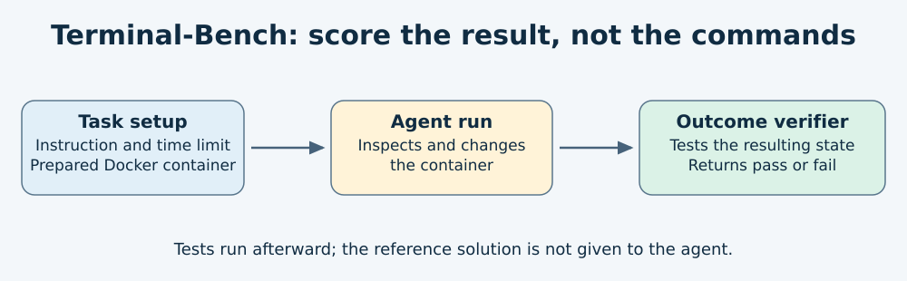

# Terminal-Bench: Benchmarking Agents on Hard, Realistic Tasks in Command Line Interfaces

## Overview

Terminal-Bench measures whether a model-driven agent can finish realistic command-line work, from modernizing legacy software to implementing research code. The paper introduces both a task framework and Terminal-Bench 2.0, a suite of 89 tasks. It scores what the agent leaves behind in a container, not whether it followed a prescribed sequence of commands. [S1] [S2]

## What

This is an evaluation benchmark, not an agent algorithm. The agent gets a task instruction and a Docker environment initialized with relevant files and dependencies, plus a time limit. After the run, tests check whether the final container state satisfies the requested outcomes. A human-written reference solution demonstrates solvability; the tests and solution are not given to the agent in the task setup. [S1] [S2]

## Terminology

| Term | Meaning in this paper | Why it matters |
| --- | --- | --- |
| Final container state | The files, programs, and other state left after the agent acts. [S1] | An explanation or a plausible command log does not earn credit by itself. |
| Oracle solution | A human-written example solution that passes the verifier. [S2] | It proves one route works without making that route mandatory. |
| Agent scaffold | The runtime that exposes tools and manages the model's interaction with the environment. Terminus 2 is the authors' terminal-only scaffold. [S3] | A score belongs to a model–scaffold pair, not just to the model. |
| Resolution rate | The reported rate of successful runs; a trial is one attempt at one task. [S3] | It measures average success, not whether each task succeeds on every retry. |

## Why

**Why solve this problem?** Real terminal work often requires discovering what is installed, reading unfamiliar files, and recovering when an intermediate attempt fails. A single correct command does not show that an agent can finish the job. [S1] [S5]

**What did prior work do?** Westenfelder et al.'s [LLM-Supported Natural Language to Bash Translation](https://aclanthology.org/2025.naacl-long.555/) tests translating requests into Bash commands. That isolates command generation rather than testing whether an agent can inspect a live environment, act on feedback, and complete a multi-step task. [S5]

**What does Terminal-Bench do differently, and why?** It gives the agent a live container and an end goal, then tests the result rather than prescribing a sequence of commands. That lets different valid approaches earn credit, but writing reliable tests for diverse tasks takes manual review. [S1] [S2] [S5]

## When

Use it to compare model–scaffold pairs if you build or evaluate agents for work such as migrating a legacy program while preserving its behavior. To study a model change, hold the scaffold and evaluation conditions fixed; to study a scaffold change, hold the model fixed where compatible. Separately test the security requirements, operational constraints, and connectors of your own deployment: benchmark passes show only what the verifier covers under the benchmark conditions. [S1] [S3] [S5]

## How

*Original diagram based on [Figure 2, p. 3](https://arxiv.org/pdf/2601.11868v1#page=3) [S1]. Notice the handoff: the agent changes the container, then separate tests check the outcome. The reference solution demonstrates solvability; the agent does not receive it.*

1. Start a trial with the task's container image and instruction, under its time limit. [S1]
2. Let the agent inspect and change the environment using its tools. Harbor runs the benchmark; Terminus 2 uses only a headless terminal, but the benchmark does not require every scaffold to do so. [S1] [S3]
3. Run the task's verifier in the resulting container. The run resolves the task only if its required outcomes pass; the verifier does not grade the sequence of commands. [S1] [S2]
4. Repeat the benchmark for each supported model–scaffold pair. The authors report at least five runs per supported pair and 32,155 individual task attempts in total. [S3]

## Worked Example

**Paper example:** In `cobol-modernization`, the agent receives an existing COBOL program, an input file, and starting data files. It implements the same logic in Python. The comparison runs the two implementations from equivalent inputs and initial data, then checks that the resulting accounts, books, and transactions files match byte for byte. [S1] [S6]

To see what the outcome check means, suppose the accounts and transactions files match but the books file differs by one byte. Two matches cannot satisfy the requirement that all three match, so the trial fails. If all three match and the remaining verifier checks pass, the run resolves the task regardless of the implementation path. The one-byte difference is illustrative, not a reported trial result. [S1] [S6]

## Differentiators

- **Versus terminal command benchmarks:** Translating a request into Bash or improving a single script isolates a particular skill. Terminal-Bench asks whether an agent can use an environment over multiple steps to achieve an externally checked result. [S1] [S5]
- **Versus τ-bench:** Both evaluate outcomes, but τ-bench tests whether an agent can elicit missing details from a simulated user and act under policy; its checks include database state and user-facing answers. Terminal-Bench tests what an agent achieves in a container from a task instruction. [S1] [S5] [S7]

## Evidence

The strongest reported pair was **GPT-5.2 + Codex CLI at 62.9% ± 3.0 percentage points**, followed by **Claude Opus 4.5 + Terminus 2 at 57.8% ± 2.5 points** and **Gemini 3 Pro + Terminus 2 at 56.9% ± 2.5 points** (95% confidence intervals). With the same GPT-5.2 model, Terminus 2 reached **54.0%**, 8.9 points below Codex CLI in this setup. These are paper results, not current leaderboard scores. [S3]

The paper describes an **89-task** suite, but Table 2's caption says its token counts cover “all 74 tasks.” The caption does not explain that discrepancy; do not infer a 74-task score denominator or per-task token costs from it. [S1] [S3]

## Relationships

[τ-bench](../2024/arxiv-2406.12045.md) is a contrast in task design: customer-service state and answers under policy versus the end state of a command-line environment. [S1] [S5] [S7]

## Technical Depth

### What was submitted, and what was evaluated?

A **contributor** is a person who helped create benchmark tasks. A **contribution** or **submission** here is a proposed task sent to the project's GitHub for review, not an answer submitted by an agent. A **task** is one reusable evaluation scenario: an instruction, a starting Docker environment, a time limit, verifier tests, and an example solution. In the paper's count, 93 contributors created 229 proposed tasks; the authors selected 89 for Terminal-Bench 2.0 based on author-estimated difficulty and human quality review. [S1] [S2] [S9]

A **trial** is one model–scaffold pair's attempt at one task. The authors report at least five benchmark runs per supported pair and **32,155 trials** in total. For the Terminus 2 task-level results, the resolution rate is the fraction of attempts at that task that pass for a given model: three passes in five attempts would give 60%. [S3] [S8]

The paper gives two different model counts: §3 says 16 models across six scaffolds, while Table 2 lists 21 distinct model names across 55 reported model–scaffold pairs. [S3]

### Domain coverage is not domain-level scoring

Task authors assigned one high-level category to each task. Figure 4 counts tasks, not successful trials. Its 16 categories sum to 89 tasks, but coverage is uneven: software engineering accounts for 26 of 89 tasks (about 29%), and five categories have one task each. [S2]

| Tasks per category | Contributor-assigned categories |
| --- | --- |
| 26 | Software Engineering |
| 9 | System Administration |
| 8 each | Data Science, Security, Scientific Computing |
| 5 each | File Operations, Debugging |
| 4 each | Data Processing, Model Training, Mathematics |
| 3 | Machine Learning |
| 1 each | Games, Video Processing, Data Querying, Optimization, Personal Assistant |

The category describes the work; it does not determine the score. Table 2 reports overall resolution rates by model–scaffold pair, and Figure 11 reports per-task rates by model for Terminus 2. Neither gives aggregate pass rates by domain. A category with one task shows performance on that task, not how well an agent generalizes across the field. [S2] [S3] [S8]

### How ground truth is specified and checked

**Ground truth (GT)** here means what counts as a correct outcome for a task. It is not a single answer label or an official sequence of commands. The task author describes the required outcomes in the instruction and encodes them as executable checks in the **verifier**. The **oracle solution** is a separate, human-written example that produces a state the verifier accepts. Its job is to show that the task is solvable, not to dictate how an agent solves it. [S1] [S2] [S9]

1. **Check the task before inclusion.** The automated workflow checks that the oracle passes and that a no-op attempt fails. Reviewers check that the tests cover the requested behavior without imposing undisclosed requirements. These checks show that at least one solution works and doing nothing is insufficient; they do not prove that the verifier recognizes every valid outcome. [S2] [S9]
2. **Check the agent's result after the trial.** The agent gets the instruction and starting container. After it runs, the verifier tests the files, programs, or other state it left behind. The tests can run a program to check its behavior; they do not grade the agent's command history or terminal transcript. [S1] [S2]

**How expected outputs are generated in one task:** In `cobol-modernization`, the original GnuCOBOL program generates the reference outputs. The comparison runs it and the agent's Python implementation with the same input and equivalent starting data. It then compares the resulting accounts, books, and transactions files byte for byte. If the books file differs, that check fails even if the other two match. This reference-output comparison is specific to the task; others check required behavior directly, such as whether an asynchronous job runner cleans up jobs when interrupted. [S1] [S2] [S6]

## Source Locators

- S1: §§1–2.2, pp. 2–3; Figure 2
- S2: §§2.3–2.4, pp. 4–5; Figures 3–4
- S3: §§3–4, pp. 6–7; Figure 1, p. 3; Appendix A.3, p. 21; Table 2, p. 81
- S4: §4.4 (trajectory-level error analysis), p. 9; Figure 8
- S5: §§5–6 (limitations and related work), pp. 10–11
- S6: Appendix H, cobol-modernization, p. 57
- S7: τ-bench arXiv:2406.12045v1, §§3.1–3.3, pp. 3–5
- S8: Appendix A.3, p. 21; Figure 11, p. 22
- S9: Appendix B.1, p. 21 (contributor checklist)

## FAQ

### What is an agent scaffold?

A **scaffold** is the software around the model that turns its requests into actions. The model can ask to read a file, but the scaffold actually runs the request and shows the model what came back. Different scaffolds can give the same model different tools, such as a dedicated file editor or just a terminal. That's why a Terminal-Bench score is for a **model–scaffold pair**, not the model alone. [S3]

### What is Harbor?

**Harbor runs the test; it doesn't solve the task.** It starts the task's container, runs the chosen agent under the task's time limit, and runs the verifier tests afterward. **Terminal-Bench 2.0** supplies the tasks; **Harbor** runs them. Harbor can run Terminus 2 or another scaffold. [S1] [S3]

### What is Terminus 2?

**Terminus 2 is one specific scaffold, not a model.** Its only tool is a terminal: it sends the model's keystrokes to a persistent `tmux` session in the container and sends the screen output back. The model can use a text editor through that terminal, but it doesn't get a separate file-editing tool. On long runs, Terminus 2 can ask a model to summarize progress when the context fills up. [S3] [Appendix F, p. 51, Figure 34](https://arxiv.org/pdf/2601.11868v1#page=51)

**Illustrative example:** A toy task says, "Read `name.txt` and save a greeting in `greeting.txt`." The test expects `Hello, Ada!`.

1. **Harbor sets up the trial.** It starts a container with `name.txt` and launches the agent. The task tells the agent what to do, but the verifier is not provided to the agent at the start.
2. **The model picks an action; Terminus 2 carries it out.** The model asks to type `cat name.txt`. Terminus 2 sends those keystrokes to the terminal and returns the output, `Ada`. Now the model knows which name to use.
3. **The model makes the next decision.** It asks to type `echo 'Hello, Ada!' > greeting.txt`. Terminus 2 sends the keystrokes, and the shell writes the file. If the model only *says* it wrote the file, the file still won't exist.
4. **Harbor runs the verifier.** It checks whether the file contains the expected greeting. A correct file passes even if the agent used a different command to create it. [S1] [S3] [Appendix F](https://arxiv.org/pdf/2601.11868v1#page=51)
