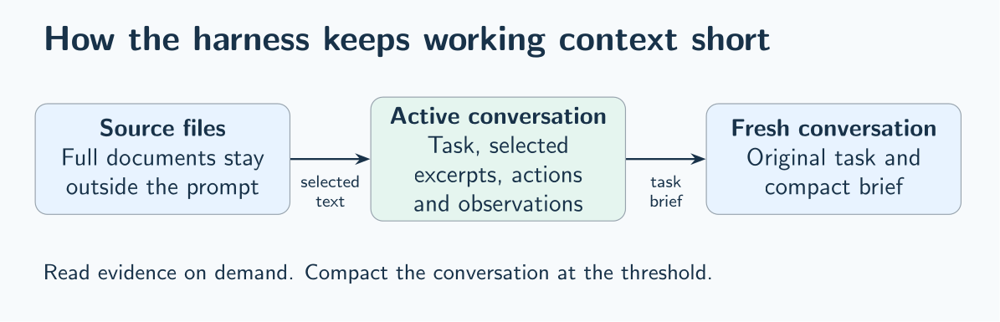

# You don’t need long context

## Overview

This paper tests whether agents need to keep all available information in the model's active context. It changes what the harness sends to existing models, not the models themselves: summarize a growing conversation into a handoff, or let the agent retrieve just the passages it needs from a large input. Across the tested workloads, these changes usually kept accuracy near or above the full-context baselines; that does not make old evidence dispensable. [S2] [S3] [S4] [S5]

## What

The study starts with either a task that generates a long sequence of tool actions and observations or a question with a large source document collection. The harness changes how the model sees the history or documents, while the final patch, tool outcome, or answer is still scored by the benchmark. The main accuracy experiments use Claude Opus 4.5 and GPT 5.6 Sol; separate open-weight model measurements inform the cost estimates. [S1] [S2] [S6]

## Terminology

| Term | Meaning in this paper | Why it matters |
| --- | --- | --- |
| Peak live context | The length of the largest conversation segment during a task, not the sum of all segments. [S2] | A short peak does not imply few tokens spent across the whole run. |
| Full-history accumulation (FHA) | Append each action and observation to one conversation without replacing old messages. [S2] | This is the long-horizon baseline, distinct from giving a long document up front in the long-input experiments. |
| End-of-conversation compaction (EoCC) | At a threshold, generate a task handoff and resume in a fresh conversation. The higher total limit leaves room for the handoff. [S2] | The summary replaces prior turns in active context; it need not preserve every exact fact. |
| Single-action compaction (SAC) | Update the textual handoff after each environment action and start a fresh conversation for the next action. [S2] | One action per conversation is not one action per task. |
| Selective input reading | Leave documents in files and let the agent choose which passages to load using search and bounded reads. [S2] [S4] | Large source inputs can remain available without all of their tokens entering the model. |

## Why

**Why solve this problem?** A coding agent's log can grow even when the next decision needs only a few facts. The paper's system measurements show lower decode throughput at longer contexts; its cloud analysis estimates a higher cost per output token at fixed GPU prices. [S1] [S6]

**What did prior work do?** The released mini-swe-agent uses a minimal ReAct loop: take an action, observe the result, and append both to the conversation. This preserves all previous observations, but the default loop does not bound the growing history. Likewise, the standard full-input baselines place the entire benchmark input in context. [S2] [S4]

**What does this paper do differently, and why?** It keeps the action loop but replaces accumulated messages with a brief aimed at the work still to do. For long documents it changes the input interface too, so the agent can retrieve exact passages instead of carrying the whole source. A handoff can lose exact details, and retrieval helps only if the underlying material remains available and the agent can find it. [S2] [S3] [S4]

## When

An engineer building a coding agent can compare compaction policies on long patch-and-test tasks. Across six long-horizon benchmarks, at most 5 of 22 threshold configurations per model lost more than two percentage points versus full history. The authors separately tested per-action compaction on SWE-bench Verified and Terminal-Bench 2.1. On SWE-bench Verified, GPT 5.6 Sol went from 84.4% to 82.4% resolved, while median peak context fell from 18K to 7K tokens. [S3] [S5]

Those scores measure task success, not whether the agent can recall arbitrary details from earlier turns. For workflows that need exact old tool output, the authors suggest storing the trace separately and making it searchable; they do not establish that a compact summary alone can reproduce it. They also do not show that short context suffices for every workload. [S3] [S5]

## How

1. **Keep the action loop.** Give the model the task. It takes an action, sees the result, and uses that observation to choose what to do next. Full history leaves those turns in one conversation. [S2]
2. **Replace history with a handoff.** When EoCC crosses its threshold, ask the model for a bounded brief with the objective, established facts, relevant artifacts and next steps. Restart with the same system instructions, the original task and the brief. SAC instead does the update after every action and observation. [S2] [S3]
3. **Keep large source inputs outside the prompt.** For long-input benchmarks, give the agent the question and file information. It searches and reads bounded passages, and uses EoCC if that working conversation grows too large. [S2] [S4]
4. **Compare outcomes and token use separately.** Sparse reads and shorter conversations change both what evidence the agent sees and what inference consumes. The authors report benchmark scores and token accounting; their optimized retail cost adds a context-dependent pricing assumption. [S3] [S4] [S6]

*Original diagram based on [Sections 2.4.1–2.4.2](https://arxiv.org/pdf/2611.05306v1#page=7). Reading a file excerpt and compacting a conversation solve different problems: one controls how much source text enters, and the other controls how much working history stays.* [S2]

## Worked Example

**Paper example:** In a recorded LongBench v2 run, the question asks for a translation using a Kalamang grammar file of 18,830 lines. The agent searches for a word in the sentence, finds a hit at line 3,840, then requests lines 3,835–3,870: a 36-line excerpt that includes the hit. It follows up with another bounded read to check grammar and examples rather than treating the keyword match as the answer. The trace shows the intermediate evidence entering context, not a reported final translation, typical read size, or success rate. The benchmark scores the final multiple-choice answer separately. [S2] [S4]

## Differentiators

- **Short context is not short total work.** Compaction can require the agent to read or do something again. Peak context, total tokens and task accuracy should be tracked independently. [S2] [S3]
- **Optimized cost is not the API bill.** On LongBench v2, GPT 5.6 Sol went from 70.8% to 72.6% with selective reading and compaction (16K limit, 12K threshold). The estimated optimized cost fell from $79.20 to $18.04, but the same run's nominal cost at standard rates rose to $90.20. The estimate extrapolates from throughput measurements of three open-weight models; it is not a measured discount for the tested closed-weight endpoint or an isolated effect of compaction. [S4] [S6]
- **SAC is demonstrated; a purpose-trained model is proposed.** Section 5 runs existing models with a textual handoff. Section 5.1 proposes post-training a *semantic state space model* to carry out that handoff natively; the SAC results do not evaluate such a model. [S5]

## Relationships

- **Contrasts with** [WikiTrace](arxiv-2611.14320.md#how): compaction carries progress forward within one active task; WikiTrace carries lessons across tasks and lets the agent inspect their source runs. [S2] [S3]
- **Uses** [SWE-bench](../2024/arxiv-2310.06770.md) via the human-validated Verified subset to compare patch success across context policies. The results are not for the original full suite. [S2] [S5]

## Source Locators

- S1: Section 1 and Figures 1–2, pp. 1–3
- S2: Sections 2.1–2.4 and Figure 3, pp. 3–7
- S3: Sections 3–3.1 and Figure 5, pp. 9–10; Appendix A, p. 20
- S4: Section 4 and Figure 6, pp. 11–13; Appendix E.2, pp. 25–26; Appendix F, Table 11, p. 27
- S5: Sections 5–6 and Table 2, pp. 14–15
- S6: Appendix B, Equations 1–4, pp. 20–21

## FAQ
