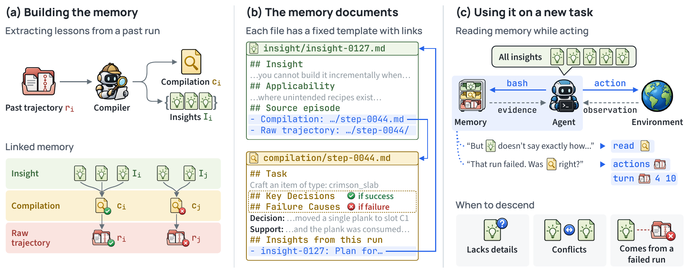

# Don't Just Trust Your Memory: Evidence-Linked Memory Reduces Memory-Induced Degradation in LLM Agents

## Overview

WikiTrace is an evidence-linked memory system for agents, not a way to guarantee that stored lessons are correct. It turns past task runs into concise lessons linked to their source summaries and raw trajectories, allowing an agent to check a lesson while solving a new task. [S1] [S2]

## What

The input is a fixed collection of past tasks, action/observation trajectories, and success-or-failure labels, without gold explanations. A compiler creates an indexed, read-only memory; a test agent receives the resulting insights and can inspect linked evidence with terminal tools before acting. The output is the agent's task actions and result, not a verified or permanently corrected memory. [S2]

*Paper [Figure 2, p. 3](https://arxiv.org/pdf/2611.14320v1#page=3): “Overview of WikiTrace. (a) A compiler turns each past run into a compilation, a diagnosis of why the run succeeded or failed, and insights, each a concise lesson. All layers stay linked. (b) Each layer's documents follow a fixed template. (c) The agent starts from every insight and descends through the links under the conditions shown.” Notice that source access is selective rather than automatic verification. [S2]*

## Terminology

| Term | Meaning in this paper | Why it matters |
| --- | --- | --- |
| Trajectory | A past run's actions and observations, stored with its task and outcome. [S2] | It preserves the evidence behind a lesson, even when the lesson is misleading. |
| Compilation | A generated account of a run's decisions and supporting observations, or plausible failure causes. [S2] | It is a navigable intermediate summary, not a verified diagnosis. |
| Insight | A concise lesson, its applicability, and links to the run and compilation it came from. [S2] | It is cheap to read but can be wrong, incomplete, or conflict with another insight. |
| Descent | Reading a linked compilation or raw trajectory to investigate an insight. [S2] | It can recover details missing from the compressed lesson. |
| Gain vs. Regression | Gain is success on tasks whose majority no-memory outcome was failure; Regression is failure on tasks whose majority no-memory outcome was success. [S3] | Overall score alone can hide cases in which memory harms previously solvable tasks. |

## Why

**Why solve this problem?** Agents distill experience into reusable lessons, but a run's success or failure alone does not establish which action caused it. A wrong lesson, or a valid lesson applied in the wrong setting, can make an agent fail a task it could otherwise solve. [S1] [S2]

**What did prior work do?** ExpeL extracts and maintains rules from experiences, while ReasoningBank distills strategies from successes and failures and retrieves them by task similarity. The paper's adapted baselines give the agent extracted guidance without a linked path back to the original trajectory, making it harder to inspect the basis of an individual lesson. [S1] [S3]

**What does WikiTrace do differently, and why?** It keeps each per-run insight linked to the compiler's account and the unchanged source run, and prompts the agent to inspect evidence when a lesson is uncertain or incomplete. This trades more storage, context, and reading cost for the opportunity to reassess guidance; the link itself does not prove that the interpretation or action is correct. [S2] [S4] [S5]

## When

An agent developer can use WikiTrace when reusing prior runs for tasks such as controlling simulated apps or completing crafting tasks, especially when concise lessons disagree or omit a necessary detail. The linked observations can help the agent decide whether a lesson fits the current situation, but a separate check is still needed for correctness, safety, and use in real environments. [S2] [S3] [S5]

The authors compare WikiTrace with no memory, AWM, ExpeL, ReasoningBank, and **Insights Only** on eight suites across five benchmarks, including [AppWorld](../2024/conference-acl-long-850.md). With DeepSeek-V4-Flash, the mean of suite scores was **90.2** for WikiTrace, **87.0** for Insights Only, and **79.5** for no memory; suite metrics differ. Mean Regression was **4.5%** versus **6.5%** for Insights Only. These are averages over three trials in the paper's selected benchmark setups, not guarantees for other agents or tasks. [S3]

## How

1. **Build once:** For each no-memory training run, a compiler reads the task, trajectory, and binary outcome. It writes one compilation and up to three separately sourced insights; the raw run remains unchanged. [S2]
2. **Freeze and present:** The corpus is indexed and mounted read-only. At test time the agent sees all insights, plus identifiers and titles for insights from three similar past tasks. [S2]
3. **Inspect selectively:** The prompt asks the agent to follow links when an insight lacks details, conflicts, came from a failed run, or an action fails. It can read a summary or raw actions and observations before choosing how to proceed. The paper compares this with the same insights supplied without source access or the descent prompt. [S2] [S3]
4. **Act without rewriting the store:** The agent can revise its interpretation during the current task; the experiment does not update the stored insight documents. [S2] [S5]

## Worked Example

**Paper example:** In PlanCraft, the agent must craft acacia slabs. A lesson from a failed run suggests giving up if placing one plank already appears to produce another item; a conflicting lesson from a successful run says to keep adding the ingredients because the displayed output is only a preview. [S5]

1. WikiTrace opens the linked runs. The failed run repeatedly removed the plank from the grid; the successful run kept adding planks until the desired slab appeared.
2. The agent recognizes that the intermediate button or pressure plate is a preview, not an item automatically consumed from the grid. It keeps placing the three required planks and takes the resulting six slabs.
3. In the paper's illustrated run, WikiTrace succeeds. The Insights Only agent instead takes the intermediate button, consumes a plank, and declares the task impossible. This is one qualitative example, not a measured success rate or a permanent repair to the stored rule. [S5]

## Differentiators

- **Source-linked rather than insight-only:** The same insight can be checked against a summary and raw run instead of being accepted solely as a compressed rule. The comparison also changes the prompt to encourage descent, so it tests the access-and-prompt package. [S2] [S3]
- **Preserve rather than silently merge:** Insights are generated per run and are not merged or deleted, so conflicting lessons remain visible and their sources can be compared. [S2]
- **Report harm as well as help:** Gain and Regression separate newly solved tasks from previously solved tasks that fail; an additional no-memory rerun estimates the variation that can occur without memory. [S3]

The source checks have costs and limits: every insight is initially included in the prompt, so scaling to larger memories requires a retrieval method not tested here. In the reported experiments WikiTrace cost **1.17×** as much per task as Insights Only, averaged across suites, and the qualitative failure labels were made by LLM judges rather than establishing causation. [S4] [S5]

## Relationships

WikiTrace is evaluated on selected tasks from [AppWorld](../2024/conference-acl-long-850.md), which supplies an interactive simulated app environment and task-level evaluation. WikiTrace changes how the agent reuses past experience; AppWorld is one of the benchmarks used to measure it. [S3]

## Source Locators

- S1: §1–2 (introduction and related work), pp. 1–3
- S2: §3.1–3.4 (problem, memory construction, and source access), pp. 3–5; Figures 2–4; Appendix B
- S3: §4.1–4.3 (experiment setup, results, Gain, and Regression), pp. 5–6; Table 1; Figure 5; Appendix A
- S4: §5.1–5.5 (analysis, cost, and generalization), pp. 6–8; Figures 6–10; Table 2
- S5: §5.6 (resolving conflicting insights) and Figure 11, pp. 8–9; Limitations, p. 8

## FAQ
